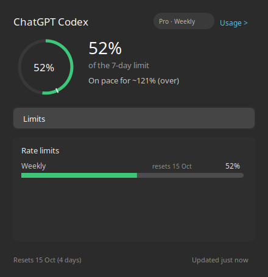
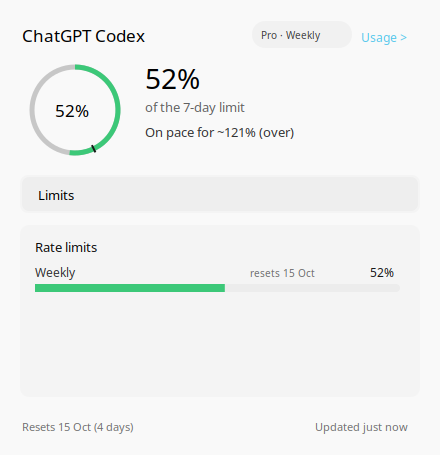
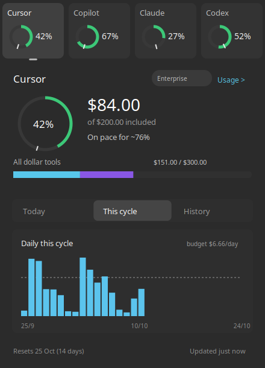

# TokenKeeper

**Keep track of your AI.**

Licensed under the [MIT License](LICENSE).

TokenKeeper lives in your system tray and monitors subscription allowances across
**Cursor, GitHub Copilot, Claude Code, ChatGPT Codex and OpenCode Go**. Check what you have used,
when your limits reset, and whether your current pace will last the cycle.

## A quick look

Current Linux/KDE panels, rendered by the app with **sample data**:

| Dark | Light |
| --- | --- |
|  |  |

Multiple accounts share one panel, with provider selection, available charts and
an aggregate allowance bar for providers that report dollar amounts:



## What it does

- Shows the selected provider's allowance in a tray ring, with colours and a pace marker.
- Opens a usage panel with reset times, available charts, history and provider dashboard links.
- Combines signed-in accounts in one panel and lets you switch the tray provider by menu or scroll.
- Supports browser sign-in, manual refresh and optional autostart on Windows and Linux/KDE.

| Provider | Usage tracked |
| --- | --- |
| Cursor | Included usage and request breakdowns |
| GitHub Copilot | Premium-request allowance and usage |
| Claude Code | Subscription rate-limit windows and available extra usage |
| ChatGPT Codex | Codex allowances included in your ChatGPT subscription |
| OpenCode Go | Console subscription quota windows, when authorized |

ChatGPT support measures Codex usage, rather than general chat-message limits.
Charts depend on each provider's available data; some history accumulates while the app runs.
OpenCode Go uses browser device authorization, verified with a live subscription
on Linux/KDE. It does not require the OpenCode CLI or an API-key paste.

TokenKeeper calls supplier web APIs directly and requires no supplier-installed apps
or CLIs. Credentials are secured with Windows DPAPI or Linux Secret Service/KWallet.

## Quick start

Install Rust. Linux also needs GTK3, Cairo, GIO, libdbusmenu, Secret Service,
OpenSSL, curl and xdg-utils; see [setup](docs/howto/setup.md) for package names.

```bash
cargo test --release --locked
cargo build --release --locked
```

Run `target/release/tokenkeeper` on Linux or `target\release\tokenkeeper.exe`
on Windows. The first launch stays idle. Right-click the tray icon, choose
**Accounts → Provider — Sign in…**, and complete browser sign-in. Left-click to
open usage; click away or press Escape to dismiss. Hover shows a summary.

## Documentation

- [Installation and autostart](docs/howto/setup.md)
- [Themes, credentials and troubleshooting](docs/howto/configuration.md)
- [Development and screenshots](docs/howto/development.md)
- [Design and provider APIs](docs/design/README.md)
